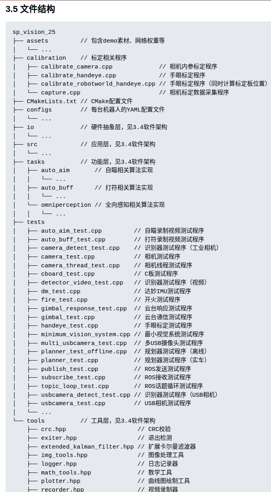

# Lesson 2：C++ 进阶

C++ 进阶就是从会用 C++ 敲代码，到能够用 C++ 开发工程级项目，主要包括多文件编写、CMake 和 OOP。

## CMake

CMake 的使用教程很多，可以先参考 Super Power 战队的教程：

[Super Power 的 CMake 教程](https://www.bilibili.com/video/BV1N3tTeoEqx/?spm_id_from=333.1387.homepage.video_card.click&vd_source=8046907425269c14afbf6084b6bdf0a2)

## 代码规范

建议所有人阅读并实践[交龙的代码规范指南](https://sjtu-robomaster-team.github.io/cpp-style-guide/)。

## OOP

OOP 即面向对象编程。在 C++ 基础知识的基础上，还需要学习封装、继承、友元等内容，这些知识适合用于团队项目开发。

参考 Super Power 战队的教程：[Hello OOP](https://www.bilibili.com/video/BV17vn9zDELW?spm_id_from=333.788.videopod.sections&vd_source=8046907425269c14afbf6084b6bdf0a2)

## 项目框架

项目框架要清晰，需要知道每个文件夹放什么、每个文件负责什么。可以参考 `sp_vision25` 的项目目录：

## Task 2

### 1. 代码建模

代码要包括机器人和外界环境这两大类。一切除开机器人本身的属性，都可以是外界环境，例如资源、温度等。

### 2. 外界环境

外界环境至少要包含资源类，纳入以下信息：

- 资源总量；
- 工具信息：名称、成本价值、稀有度、磨损度、购买难度等。

其他内容可按照官网规则自行添加。

### 3. 机器人分类

将机器人分为两大类：

- 资源型机器人；
- 战斗型机器人。

#### 共有属性

两类机器人共有以下属性：

- ID；
- 等级；
- 阵营相对世界坐标系的 XYZ、RYP（roll,yaw,pitch了解即可，具体使用方法属于后期培训内容）；
- 血量；
- 电池电量。

添加虚函数，实现充电接口，并在资源探取型和战斗型机器人中完成不同的充电功能，得到不同充电效率下充满所需的时间。

#### 资源型机器人

实现对资源的获取，包括：

- 通过比对工具信息与资源特征，判断是否可以采集；
- 比对资源机器人的 XYZ 位置，判断是否在采矿点上；
- 比对等级是否达到采矿等级；
- 判断是否已经超出容量；
- 遍历它采集的所有资源。

#### 战斗型机器人

实现以下功能：

- 判断两个战斗型机器人进行 1V1 死斗时的获胜者；
- 判断两个资源型机器人在同等时间下完成采集时的收益价值优劣。

要求逻辑自洽，建议参考比赛规则。

### 4. 要求使用的知识点

要求用到以下知识点：

- 动态内存分配
- 引用
- 枚举
- `auto` 自动类型推导
- 内联函数
- 构造函数
- 初始化列表
- 析构函数
- 运算符重载
- `explicit` 关键字
- `static` 成员
- 友元
- 继承
- 内部类
- 虚函数
- 多态

如果能加入更多知识点（比如多线程）也可以。
